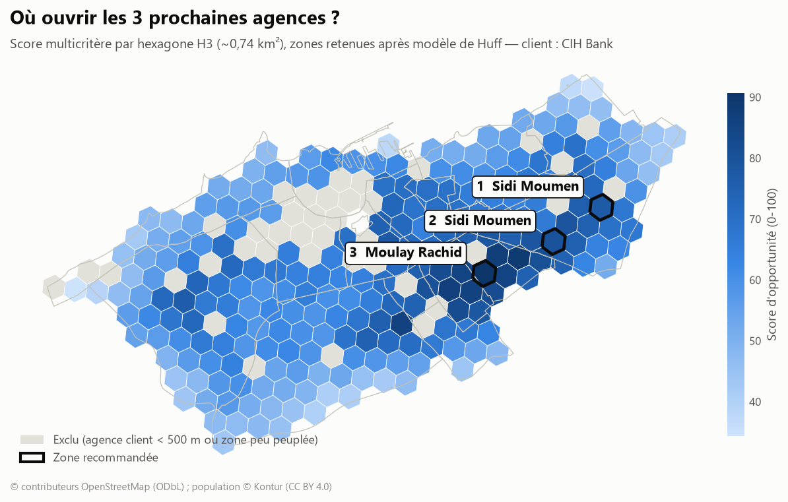
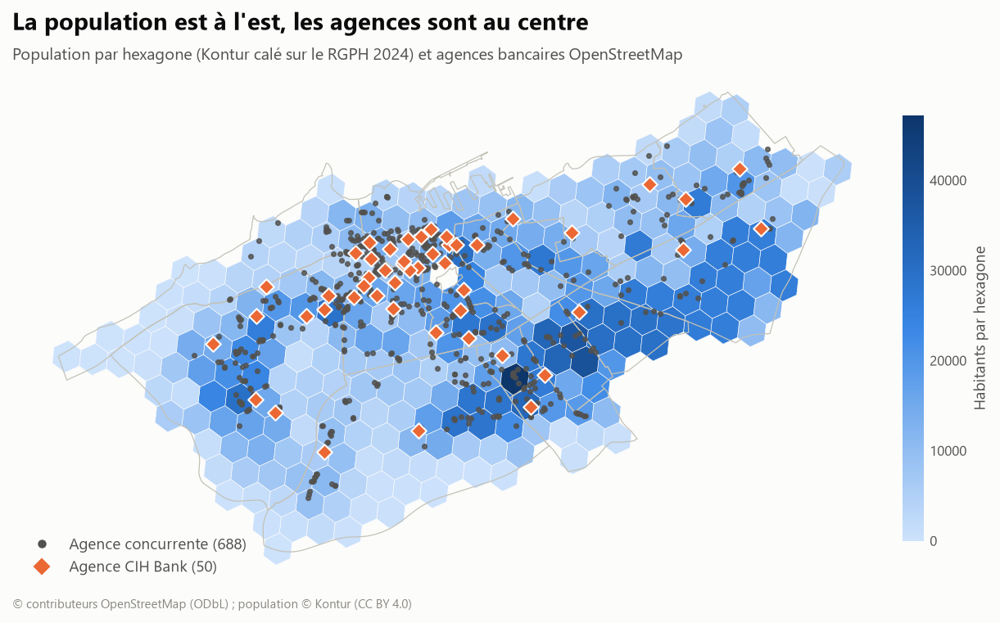
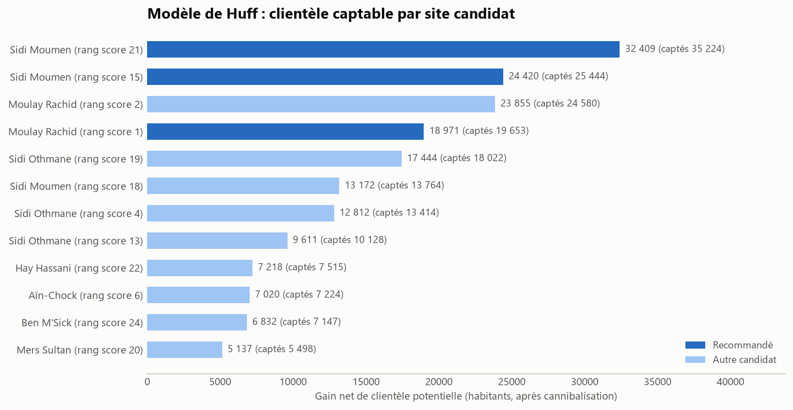

# Location Intelligence : où ouvrir 3 agences bancaires à Casablanca ?

Mission de conseil simulée : une banque marocaine de taille moyenne (CIH Bank, client fictif) veut ouvrir 3 agences à Casablanca d'ici 2027. Le projet répond à la question **« où ? »** avec des données ouvertes, une analyse spatiale sur grille H3, un modèle de Huff et un dossier de gouvernance des données.

**Dashboard interactif** avec simulateur de pondérations : [dashboard/index.html](dashboard/index.html), un fichier unique qui s'ouvre dans n'importe quel navigateur. En ligne via GitHub Pages : voir [Publier le dashboard](#publier-le-dashboard).



## Résultat

**Les 3 agences doivent aller dans la ceinture est** : 31 % des habitants de la commune, mais 6 % des agences. On y compte 21 000 habitants par agence, contre 1 150 au centre.

| # | Zone | Repère | Habitants à ~1 km | Concurrents à 1 km | Gain net Huff* |
|---|---|---|---|---|---|
| 1 | Sidi Moumen | Station Sidi Moumen Terminus, Bd Mohamed Zefzaf | 173 578 | 3 | 32 409 |
| 2 | Sidi Moumen | Station Hôpital Sidi Moumen, Bd Mohamed Zefzaf | 169 914 | 5 | 24 420 |
| 3 | Moulay Rachid | Station Hay El Falah, Av. du Commandant Idriss Elharti | 214 942 | 7 | 18 971 |

**Ouvertes ensemble, les 3 agences apportent un gain net de 74 265 habitants.** Elles ne se prennent que 2 % de clients entre elles.

\* Le gain net est le nombre d'habitants captés par la nouvelle agence, moins ceux perdus par les agences CIH existantes (cannibalisation). C'est un indicateur de classement relatif, pas une prévision de comptes ouverts.

| Les habitants sont à l'est, les agences au centre | Le modèle de Huff départage les candidats |
|---|---|
|  |  |

## Méthode

```
OpenStreetMap ─┐
Kontur (H3) ───┼─► Bronze ─► Silver ─► 273 hexagones ─► Score MCDA ─► 12 candidats ─► Huff ─► 3 zones
HCP RGPH 2024 ─┘   (brut)   (nettoyé,   4 indicateurs     (0-100)       (présélection)   (gain net)
                             calé)                                                          │
                                                   Gold (CSV) ─► Power BI (PBIP) + dashboard web
```

1. **Maillage H3 résolution 8** (~0,74 km²), l'unité d'analyse commune. On évite ainsi le MAUP des arrondissements, dont la surface va de 3 à 41 km².
2. **Quatre indicateurs** par hexagone : demande (population sur l'hexagone et ses 6 voisins), concurrence (agences à 1 km), accessibilité (tram, busway, axes), attractivité (commerces, bureaux, santé, universités).
3. **Score multicritère** : `0,35 × Demande + 0,25 × (1 − Concurrence) + 0,20 × Accès + 0,20 × Attractivité`. Les hexagones à moins de 500 m d'une agence CIH sont exclus.
4. **Entonnoir** : le score présélectionne 12 candidats, puis le **modèle de Huff** retient les 3 meilleurs gains nets, espacés d'au moins 2,5 km. Le portefeuille est ensuite recalculé avec les 3 sites ouverts ensemble.
5. **Test de robustesse** sous 5 jeux de poids : Moulay Rachid est n°1 dans tous les cas. Il faut ramener le poids de la demande à 0 pour que le centre-ville entre dans le top 10.

Tous les choix sont justifiés dans [docs/02_methodologie.md](docs/02_methodologie.md).

## Gouvernance des données

16 règles de qualité sont calculées à chaque exécution. Celles qui ont changé l'analyse :

- **98 libellés de banques → 18 marques** grâce à un référentiel qui gère le français, l'arabe et les fautes de frappe. 25 non-banques (WafaCash, Western Union, AXA…) sont retirées.
- **Kontur est juste au total (−1,7 %) mais faux par arrondissement**, de −69 % (Al Fida) à +125 % (Maârif). La population a été **calée sur les 16 chiffres officiels du RGPH 2024**, tirés du fichier Excel du HCP. Une règle vérifie que les chiffres utilisés sont identiques à ce fichier (16 sur 16).
- **Les GAB sont sous-cartographiés dans OSM** (55 pour 767 agences), donc exclus de l'analyse.
- **Fraîcheur OSM** : 73 % des agences ont été modifiées depuis moins de 3 ans. Ces modifications sont surtout une mise à jour de masse des marques en 2025, pas des vérifications terrain.

Détails : [docs/04_gouvernance.md](docs/04_gouvernance.md) (lineage, Bronze/Silver/Gold, licences) et [docs/03_dictionnaire_donnees.md](docs/03_dictionnaire_donnees.md).

## Lancer le projet

```bash
python -m venv .venv
.venv\Scripts\activate            # Windows  (Linux/macOS : source .venv/bin/activate)
pip install -r requirements.txt

python run_pipeline.py                  # tout : extraction OSM + calculs + Power BI + dashboard (~10 min)
python run_pipeline.py --from scoring   # après un changement de poids dans locintel/config.py
```

Tous les paramètres (banque cliente, poids, rayons, λ de Huff) se trouvent dans [locintel/config.py](locintel/config.py). Pour refaire l'étude pour une autre banque, changez `CLIENT_BRAND`.

## Livrables

| Livrable | Où |
|---|---|
| Dashboard web interactif, 5 pages avec simulateur | [dashboard/index.html](dashboard/index.html) |
| Projet Power BI : modèle, relations, 19 mesures DAX, curseurs What-if | [powerbi/Casablanca_Agences.pbip](powerbi/) + [guide](docs/05_guide_powerbi.md) |
| Tables Gold (schéma en étoile) | [data/gold/](data/gold/) |
| Cadrage, méthodologie, dictionnaire, gouvernance | [docs/](docs/) |
| Trame du deck (10 slides, SCR) et script de la vidéo | [docs/06_storytelling.md](docs/06_storytelling.md) |

## Publier le dashboard

Le dashboard est une page statique, sans serveur ni dépendance. Pour le mettre en ligne avec GitHub Pages :

1. Pousser le dépôt sur GitHub.
2. **Settings → Pages → Source : Deploy from a branch**, branche `main`, dossier `/ (root)`.
3. Le dashboard est alors servi à `https://<utilisateur>.github.io/<depot>/` (le fichier `index.html` à la racine redirige vers `dashboard/`).

## Structure

```
├── run_pipeline.py          point d'entrée
├── locintel/
│   ├── config.py            paramètres de la mission (dont les chiffres officiels HCP)
│   ├── ingest.py            1. sources -> Bronze
│   ├── brands.py            référentiel des marques bancaires
│   ├── clean.py             2. Bronze -> Silver (projection, dédoublonnage, calage HCP, grille H3)
│   ├── indicators.py        3. indicateurs par hexagone
│   ├── scoring.py           4. score MCDA, présélection, robustesse
│   ├── huff.py              5. modèle de Huff, choix final, portefeuille
│   ├── quality.py           6. règles de qualité
│   ├── export.py            7. tables Gold
│   ├── maps.py              8. cartes
│   ├── powerbi.py           9. projet Power BI (PBIP / TMDL)
│   ├── web.py               10. dashboard web
│   └── templates/           gabarit HTML du dashboard
├── data/reference/          fichier officiel HCP (population légale 2024)
├── data/gold/               tables prêtes pour Power BI (versionnées)
├── powerbi/                 projet Power BI généré
├── dashboard/               dashboard web généré
├── figures/                 cartes et graphiques
└── docs/                    cadrage, méthodologie, dictionnaire, gouvernance, guide Power BI, deck
```

## Limites

- La population est une estimation : Kontur 2023, calé sur le RGPH 2024 par arrondissement. À l'intérieur d'un arrondissement, la répartition reste celle de Kontur, qui plafonne vers 36 900 habitants par hexagone dans les quartiers les plus denses.
- Les limites d'arrondissements viennent d'OSM et peuvent différer légèrement des limites officielles.
- Pas de données de revenus ni de bancarisation.
- Huff suppose des agences d'attractivité égale.
- Les agences OSM n'ont pas encore été vérifiées sur le terrain (échantillon prêt dans `data/gold/verification_terrain.csv`).

## Sources et licences

- © contributeurs [OpenStreetMap](https://www.openstreetmap.org/copyright), licence ODbL 1.0
- [Kontur Population](https://data.humdata.org/dataset/kontur-population-morocco), licence CC BY 4.0
- HCP, [Recensement Général de la Population et de l'Habitat 2024](https://www.hcp.ma/downloads/RGPH-2024_t22752.html), population légale (fichier Excel)

*Projet de portfolio. La mission et le mandat de CIH Bank sont fictifs.*
