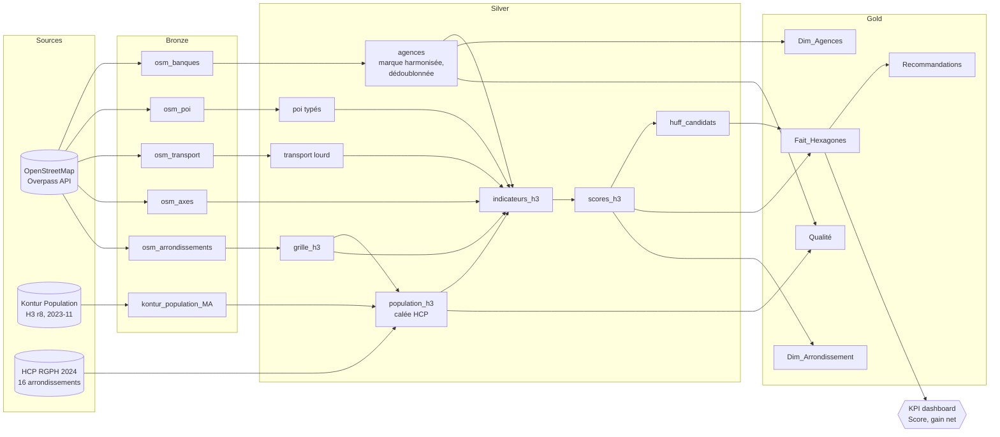

# 4. Data Governance

La question à laquelle cette partie répond : **peut-on faire confiance aux chiffres du dashboard ?**

## 4.1 Architecture Bronze / Silver / Gold

| Couche | Dossier | Règle | Contenu |
|---|---|---|---|
| **Référence** | `data/reference/` | Source officielle, versionnée | Fichier Excel HCP, population légale 2024 |
| **Bronze** | `data/bronze/` | Brut, jamais modifié, daté (`_metadata.json`) | Extractions OSM (dont dates de modification), Kontur Maroc complet |
| **Silver** | `data/silver/` | Nettoyé, harmonisé, projeté en EPSG:26191 | Agences dédoublonnées, POI typés, grille H3, population calée, indicateurs, scores |
| **Gold** | `data/gold/` | Prêt à consommer, WGS84, CSV UTF-8 | Schéma en étoile Power BI, qualité, recommandations |

Bronze et Silver ne sont pas versionnés dans Git (`.gitignore`) : ils se régénèrent avec `python run_pipeline.py`. Gold est versionné, pour que le dashboard fonctionne sans relancer le pipeline.

## 4.2 Lineage

**Exemple de traçabilité.** On part du KPI « Gain net Sidi Moumen Terminus = 32 409 ». Il vient de `huff_candidats.csv` → `huff.py`. Ce calcul utilise `population_h3.parquet` (Kontur × facteur 0,708 pour Sidi Moumen, soit 551 443 habitants selon le HCP pour 779 363 estimés par Kontur) et `agences.gpkg` (738 agences, dont 50 CIH), qui remontent respectivement à `kontur_population_MA.gpkg`, `hcp_rgph2024_population_legale.xlsx` et `osm_banques.gpkg` (extraction du 2026-09-22).

## 4.3 Référentiel des marques (master data)

OSM contient **98 libellés distincts** pour les agences, que l'on ramène à **18 marques canoniques** : « التجاري وفا بنك », « Attijarlwafa Bank », « wafa bank », « Attijari Wafa Bank » deviennent toutes « Attijariwafa bank ». Le référentiel se trouve dans [locintel/brands.py](../locintel/brands.py) et applique trois règles :

1. On teste les motifs sur `brand | name | operator | name:fr`, après normalisation (minuscules, sans accents latins, arabe conservé).
2. Les **non-banques sont écartées en premier** : WafaCash, Barid Cash, Wafa Salaf, Western Union, AXA, bureaux de change, Bank Al-Maghrib, Trésorerie Générale (25 objets). Sans cet ordre, « Barid Cash » serait classé Al Barid Bank.
3. Les motifs spécifiques passent avant les motifs larges. Une agence sans aucun libellé est classée « Non identifiée » et reste comptée comme concurrente, par prudence.

La marque **Saham Bank** correspond à l'ex-Société Générale Maroc. Le référentiel mappe les deux noms.

## 4.4 Règles de qualité

Elles sont calculées à chaque exécution dans [qualite_regles.csv](../data/gold/qualite_regles.csv).

| ID | Dimension | Règle | Mesure | Seuil | Statut |
|---|---|---|---|---|---|
| Q01 | Complétude | Agences OSM avec tag `brand` | 84,2 % | ≥ 80 % | ✅ |
| Q02 | Complétude | Agences rattachées à une marque après harmonisation | 97,8 % | ≥ 95 % | ✅ |
| Q03 | Conformité | Libellés → marques canoniques | 98 → 18 | — | ℹ️ |
| Q04 | Unicité | Doublons (même marque à < 40 m) | 10 (1,3 %) | ≤ 5 % | ✅ |
| Q05 | Validité | Non-banques taguées « bank » | 25 exclues | — | ℹ️ |
| Q06 | Complétude | GAB cartographiés par agence | 0,07 | ≥ 1 | ⚠️ GAB exclus de l'analyse |
| Q07 | Couverture | Agences hors arrondissement | 0 | 0 | ✅ |
| Q08 | Cohérence | Population Kontur vs RGPH 2024 (total) | −1,7 % | ± 10 % | ✅ |
| Q09 | Complétude | Hexagones sans population | 1 | — | ℹ️ |
| Q10 | Fraîcheur | Âge de Kontur | 35 mois | ≤ 36 mois | ✅ de justesse |
| Q11 | Exactitude | Échantillon terrain de 30 agences | à réaliser | ≥ 90 % | ⏳ |
| Q12 | Licence | Attribution OSM + Kontur | oui | obligatoire | ✅ |
| Q13 | Exactitude | Écart max Kontur vs RGPH 2024 par arrondissement | 125,4 % (Maârif) | ± 15 % | ⚠️ corrigé par calage |
| Q14 | Exactitude | Hexagones au plafond Kontur (≥ 36 900 hab.) | 30 | 0 | ⚠️ limite documentée |
| Q15 | Conformité | Chiffres de calage identiques au fichier officiel HCP | 16 / 16 | 16 / 16 | ✅ |
| Q16 | Fraîcheur | Agences modifiées dans OSM depuis moins de 3 ans | 72,9 % | ≥ 80 % | ⚠️ voir 4.5 |

**Ce que ces règles ont changé dans l'analyse :**

- Q06 : les GAB sont retirés de l'indicateur de concurrence, puisque seuls 55 sont cartographiés pour 767 agences.
- Q13 : on ajoute le calage sur le recensement, par arrondissement, à partir du fichier officiel. Les facteurs vont de 0,44 (Maârif) à 3,19 (Al Fida) ; Sidi Moumen perd 29 % de population et Hay Hassani en gagne 91 %. Le classement des hexagones et les zones recommandées en sont modifiés.
- Q15 a été ajoutée après une vraie erreur : une première version utilisait des chiffres de presse arrondis par préfecture, dont un était faux (Moulay Rachid : 475 000 dans la presse, 457 033 dans le fichier officiel). La règle relit le fichier du HCP à chaque exécution. Elle a d'ailleurs détecté un écart de libellé (« Aïn-Sebaâ » écrit avec un tiret par le HCP), corrigé dans la table de correspondance.
- Q14 : la limite est documentée. Le calage atténue le problème, sans pouvoir recréer la variation perdue à l'intérieur des hexagones plafonnés.

## 4.5 Contrôle terrain (Q11) et fraîcheur (Q16)

[verification_terrain.csv](../data/gold/verification_terrain.csv) contient 30 agences tirées au hasard (graine 42, donc reproductible), chacune avec un lien OpenStreetMap, un lien Google Maps et sa date de dernière modification. Pour chaque ligne, remplir `existe` et `marque_correcte`. Si au moins 27 agences sur 30 sont confirmées, le référentiel est validé. Sinon, il faut corriger OSM (idéalement directement sur openstreetmap.org, ce qui profite à tous) et relancer le pipeline.

**Pourquoi la fraîcheur ne remplace pas le terrain.** 412 agences ont été modifiées dans OSM en 2025, souvent le même jour pour une même marque : par exemple, 59 des 78 agences Saham Bank ont été modifiées le même jour (2025-12-08), vraisemblablement pour le changement de nom de l'ex-Société Générale. Ce sont des mises à jour de masse des marques, faites à distance. Une date récente ne prouve donc pas que l'agence existe toujours. Seul le contrôle Q11 le fait.

## 4.6 Licences et citations

| Donnée | Licence | Obligation |
|---|---|---|
| OpenStreetMap | ODbL 1.0 | Mention « © contributeurs OpenStreetMap » sur chaque carte et chaque page du dashboard. Les données dérivées diffusées restent sous ODbL |
| Kontur Population | CC BY 4.0 | Mention « Kontur Population » |
| HCP RGPH 2024 | Données publiques | Citer « HCP, RGPH 2024, population légale ». Le fichier source est conservé dans `data/reference/` |

Le texte d'attribution est prêt à coller dans [data/gold/ATTRIBUTION.txt](../data/gold/ATTRIBUTION.txt).

## 4.7 Rôles (RACI simplifié)

| Activité | Consultant data | Manager mission | Client (réseau) |
|---|---|---|---|
| Pipeline et règles de qualité | R | A | I |
| Référentiel des marques | R | C | A (valide) |
| Pondérations du score | C | R | A |
| Contrôle terrain | C | I | R/A |
